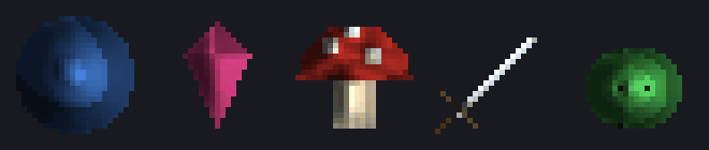
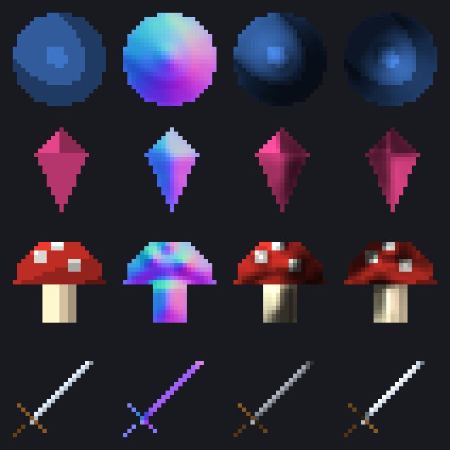

<div align="center">

# pixel-normals

**Make pixel-art sprites react to dynamic light: normal maps from PNGs, sheets and GIFs in one Python file.**

A ~320-line NumPy port of [Sprite Fusion's Sprite Normals](https://github.com/Hugo-Dz/spritefusion-sprite-normals): same algorithm, same defaults, same output files, and no Rust toolchain to install.

Works with **Claude Code** and **Codex**.

 



<sub>Real output of `python demo.py`: four sprites and a 6-frame slime animation, each lit by the same orbiting lamp through its generated normal map.</sub>

</div>

## Quick start
```bash
pip install numpy pillow
python pixel_normals.py docs/samples/mushroom.png -o mushroom_n.png
```
```
docs\samples\mushroom.png -> mushroom_n.png
```
Want to see it work first? `python demo.py` draws the sample sprites, makes their normal maps and writes the gallery and GIF below.

## Gallery

Each row: **sprite → normal map → lit from the top left → lit from the bottom right** (24×24 sprites, shown at 6×).



| Input | Command | You get |
|---|---|---|
| One sprite | `python pixel_normals.py hero.png -o hero_n.png` | `hero_n.png` |
| A folder | `python pixel_normals.py sprites/*.png --output-dir normals` | `normals/<name>_n.png` for each |
| A sheet with 24×24 cells | `python pixel_normals.py docs/samples/slime_sheet.png --frame-size 24x24 -o slime_n.png` | normal atlas + `slime_n.color.png` + `slime_n.frames.json` |
| A GIF or APNG | `python pixel_normals.py docs/samples/slime.gif -o walk_n.png` | frames packed into a square atlas + color atlas + frame timing JSON |
| Unity / Unreal green channel | add `--normal-format directx` | green channel reversed |
| Stronger relief | add `--normal-strength 2.5` (default 1.5) | deeper bevels |

## The problem
- Flat pixel art looks pasted on when a game has moving lights, torches or a day/night cycle.
- Painting normal maps by hand for every frame of every animation takes longer than drawing the sprite.
- The best open-source generator ships as Rust source: you need a Rust toolchain and a 3-minute release build before the first map.

## The solution
| Idea | Fixes |
|---|---|
| **Silhouette volume** from an exact distance transform, so every sprite gets a rounded bevel | Flat sprites under dynamic light |
| **Painted shading as relief** (Oklab lightness, opacity-weighted blur) | Hand-painting normal maps |
| **Per-island, per-frame processing**: separate shapes and sheet cells never bleed into each other | Broken edges on sheets and animations |
| **One Python file**, NumPy + Pillow, same CLI flags as upstream | Installing and building a Rust project |

## Use with Claude Code
```bash
/plugin marketplace add Dodai0419/pixel-normals
/plugin install pixel-normals@pixel-normals
```
Then ask: *"make normal maps for everything in assets/sprites and put them in assets/normals"*.

## Use with Codex (ChatGPT)
```bash
git clone https://github.com/Dodai0419/pixel-normals && cp -r pixel-normals/skills/* ~/.codex/skills/
```
Or copy `AGENTS.md` into your project root.

## Same output as upstream
The pipeline is the same: alpha mask → 8-connected islands → padded exact EDT → log falloff → Gaussian → Oklab lightness detail at two scales → Sobel → normal vector. The port keeps upstream's `f32` math (kernel order, `mul_add` in the normal length) so results line up with the Rust library pixel for pixel:

| Input (all default settings unless noted) | Pixels byte-identical to upstream | Max difference |
|---|---|---|
| 4 sample sprites (orb, gem, mushroom, sword) | 100% | 0 |
| `slime.gif` (atlas + color atlas + frames.json) | 99.5% | 1/255 (color atlas and JSON identical) |
| `slime_sheet.png --frame-size 24x24` | 99.6% | 1/255 (JSON identical) |
| `orb.png --normal-strength 3 --normal-format directx` | 100% | 0 |
| upstream's own `static/hero.webp`, converted to PNG (864×416) | 99.8% | 1/255 |
| 96×96 random-noise sprite (19 separate islands) | 100% | 0 |

The remaining 1/255 differences come from `exp`/`cbrt` rounding between libm and NumPy. `tests/golden/` holds upstream output for the samples and the test suite checks the port against it.

## Benchmarks
Measured on Windows 11, Python 3.11.1, NumPy 2.4.6, Pillow 12.3.0. Upstream is commit `d14b067` of Hugo-Dz/spritefusion-sprite-normals, built with Rust stable (`x86_64-pc-windows-gnu`, release profile) and called through a 30-line driver, because its `clap` CLI could not be linked with this toolchain. Times are the mean of 20 calls (3 for the large image), three runs each, on a busy machine.

| | upstream (Rust) | pixel-normals (Python) |
|---|---|---|
| lines of code (generator + CLI) | 1,101 (11 `.rs` files) | **319** (1 file) |
| what you install | Rust toolchain + 6 crates, then a release build (3 min 02 s here) | `pip install numpy pillow` |
| 24×24 sprite (`orb.png`) | 0.5–1.1 ms | 3–10 ms |
| 6-frame GIF (`slime.gif`) | 1.1–3.7 ms | 8–17 ms |
| 864×416 opaque image (upstream `hero.webp`) | 0.27–0.70 s | 1.9–7.1 s |

The port is slower than Rust (about 5–10× on these inputs). It is meant for asset pipelines and agents, where a sprite takes milliseconds either way and skipping the toolchain matters more. If you process thousands of large images, use upstream.

Reproduce: `python -m unittest -q` (golden comparison), `python demo.py` (gallery), and time `pixel_normals.process()` with `time.perf_counter`.

## Inspired by
- [Hugo-Dz/spritefusion-sprite-normals](https://github.com/Hugo-Dz/spritefusion-sprite-normals) (MIT): the algorithm, defaults, CLI flags and test cases, ported to NumPy.
- [Sprite Fusion](https://www.spritefusion.com/sprite-normals) also runs this generator online.

## Roadmap
- [ ] `--preview` flag that writes a lit GIF next to each normal map
- [ ] Godot / Unity import snippet in the skill
- [ ] Optional SciPy fast path for very large single shapes

## License
MIT. Includes the copyright notice of the upstream project.
